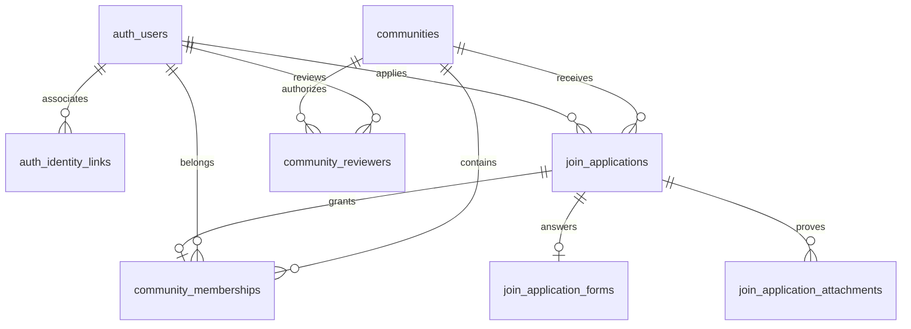

# RFC：Exre 公开注册、第三方关联与社区申请

状态：技术细化稿，待用户确认。产品设计已于 2026-10-12 经用户全文确认；本文已对照当前源码补充实施约束，不代表实现已获授权或验收通过。

日期：2026-10-12。

本次目标 Contract 版本：`0.7.0`，用户已于 2026-10-12 确认。当前实际 Contract 仍为 `0.6.0`，实施时与新接口及生成物同步更新；本次版本确认不建立长期版本策略，也不代表本文全部技术细节或实施已获批准。

源设计：`.notes/public-registration/specs/2026-10-12-public-registration-and-community-membership-design.md`，保持原文件不变。

模块根目录：`.notes/public-registration/`。本 RFC 覆盖该源设计的网站侧完整范围，游戏端接入另行设计。

## 1. 决策摘要

将邀请注册改为公开注册，账户继续使用永久 UUID。邮箱用于登录和查重；第三方身份是可解除的关联。社区申请和资格归属于账户 UUID，审核与注册分离。

本期实现邮箱注册及 Cfx 注册、登录、关联。Google、QQ 显示禁用预留入口。所有账户必须设置密码；第三方带回邮箱在注册时只读、免本站邮箱验证，邮箱重复时先登录已有账户再关联。

社区有独立配置和审核授权。Rifling911 要求 Cfx 关联；每个账户对每个社区只能申请一次，所有状态都占用机会，Cfx 不参与申请去重。审核通过原子写入成员资格和通知事件；解绑或换绑不撤销资格、不允许重新申请。

采用一个端到端 RFC，保持注册、关联与社区的依赖和切换一致。具体模块可以逐步实现，但最终 Contract、Web 和 Server 同步切换，不保留两套生效注册流程。

## 2. 事实、约束与范围

### 2.1 已核实的当前实现

| 当前事实 | 来源 | 影响 |
| --- | --- | --- |
| 账户有独立 ID、唯一邮箱和必填密码哈希。 | `apps/server/src/db/schema.ts`、`apps/server/src/domains/join/invitations/service.ts` | 延用 UUID v4，不重建既有账户。 |
| 已有邮箱账号不能提交当前申请；审批负责发注册邀请。 | `apps/server/src/domains/join/applications/service.ts` | 必须替换该冲突判断与审批副作用。 |
| 申请由邮箱历史登记限制，未保存申请人 UUID 或社区 ID。 | `apps/server/src/db/schema.ts` | 增加申请归属及社区全状态唯一约束。 |
| Cfx 返回浏览器绑定的身份证明，服务端一次性消费。 | `apps/server/src/modules/cfx/types.ts`、`apps/server/src/modules/cfx/service.ts` | 消费真实服务结果，不能提交身份 JSON 代替授权。 |
| Cfx HTTP 的 Origin、Cookie 和操作守卫只筛选当前五个 operation。 | `apps/server/src/modules/cfx/api/plugin.ts` | 新消费接口须显式安装同等守卫，不能因路径含 cfx 就假定已受保护。 |
| 通知 `publish()` 自行开启事务。 | `apps/server/src/modules/notifications/producer.ts` | 增加已有事务入口，避免审批与通知双事务。 |
| 通知导航 registry 尚无本人申请结果目标。 | `apps/server/src/modules/notifications/actions.ts` | 增加固定结果页目标及对应受限 HTML 路径。 |
| 启动和 migration runner 核对完整表集合、列和索引。 | `apps/server/src/db/schema-check.ts`、`apps/server/src/db/migration-runner.ts` | schema、完整历史集合和就绪检查同步更新。 |
| 当前 Contract 为 0.6.0，未建立路径版本或兼容策略。 | `api/openapi.yaml`、`.ai/architectures/api/contract-layout.md` | 破坏性变更单独评审并确认 Contract 版本，不自行建立兼容层。 |

源设计明确限制：不修改 Exre 邮箱，不开放 Google、QQ，不提供重新申请、申诉、成员退出或社区封禁管理，不实现游戏入服协议，不部署上线。QQ 联系字段和本人手填 FiveM ID 均不代表第三方关联证明。

### 2.2 成功条件

邮箱和 Cfx 两条路径都创建带密码的 UUID 账户，重复邮箱和关联竞争均无半成品；绑定可管理而不改变账户身份。本人可以查询自己的各社区状态，审核员不能访问未授权社区资料。决定、成员资格及通知事件要么同时提交，要么全部回滚。原账号、头像、申请及附件保留，旧邀请不能继续建号。

## 3. 模块边界与依赖

以下新增目录与服务名称是本 RFC 的实施提案。

| 模块 | 服务与责任 | 业务插件运行时依赖 |
| --- | --- | --- |
| `modules/auth/` | `authServices`：密码验证、账户写入、在给定事务内签发本站会话、停用及会话复核。 | 保持现有基础注册。 |
| `modules/identity-links/` | `identityLinkServices`：关联仓储、当前关联查询、Cfx 关联意图及本人变更。 | `business-auth`、`business-cfx`。 |
| `modules/registration/` | `registrationServices`：邮箱验证、注册授权、Cfx 登录或注册分流；协调 auth 和关联服务。 | `business-auth`、`business-cfx`、`business-identity-links`。 |
| `modules/communities/` | `communityServices`：社区配置、平台 admin 检查、审核员授权、成员状态与当前要求。 | `business-auth`、`business-identity-links`。 |
| `domains/join/` | `joinServices`：表单、附件、一次申请、范围内审核及历史读取。 | `business-auth`、`business-communities`、`business-notifications`。 |
| `modules/notifications/` | 现有 `notifications`：结果事件发布、内容、收件与异步投影。 | 保持公共模块，不反向依赖 join。 |
| `modules/cfx/` | 现有 `cfxServices`：外部证明；不保存账户关联。 | 保持现有基础注册。 |

所有核心 service/factory 通过构造参数依赖公开能力，不访问 Fastify request/reply。各入口用 `fastify-plugin` 暴露自身 decorator，并在自己的 `fastify.d.ts` 声明；注册检查实际依赖 decorator。新增服务字段进入 `apps/server/src/business-services.ts`，装配更新 `apps/server/src/create-services.ts`、`apps/server/src/server.ts` 和测试夹具，不在 import 时打开数据库或启动任务。注册与登录共享装配层的同一个 PasswordHasher，维持当前最多两项并行、十六项等待的总密码工作预算，不能各自创建队列放大容量。

AuthService 增加内部公开事务方法：`createAccountInside(tx, verifiedRegistration, passwordHash)`、`createSessionInside(tx, userId)`、`assertSessionCurrent(session, tx, lock)`；最后一个已存在，延用其语义。前两个仅由可信业务服务调用，不暴露任意 userId 登录 HTTP。注册凭证检查属于 registration，外部证明与关联检查在对应服务中完成；auth 不反向依赖 registration 或 join。

IdentityLinkService 提供 `findBySubjectInside(tx, provider, subject)`、`listInside(tx, userId)`、`createInside(tx, verifiedIdentity, userId)`，并拥有本人关联意图与解绑编排。CommunityService 提供 `assertReviewerInside(tx, session, communityId)`、`assertPlatformAdminInside(tx, session)`、`requirementsInside(tx, communityId, userId)` 和成员写入入口。JoinService 始终从验证过的 session 推导申请人或审核人，不能接受客户端声明的身份。

各模块的 `api/operations.ts` 显式登记 operation，汇总至 `apps/server/src/http/service-handlers.ts`；所属 API 插件在 `apps/server/src/http/plugin.ts` 中统一安装，然后检查覆盖并注册一次带 `/api` 的 Glue。

### 3.1 事务能力与装配约束

`Inside` 方法接受现有 `SqlExecutor`，只使用传入 executor，不打开嵌套事务。其返回值不得在调用方事务提交前作为 HTTP 成功响应发送。下列接口是目标内部能力，不是新 HTTP endpoint：

| 能力 | 参数与职责 |
| --- | --- |
| auth 账户创建 | `createAccountInside(tx, {email, nickname}, passwordHash)`：生成 UUID，插入普通启用账户；不写 admin、审核授权或会话。 |
| auth 会话签发 | `createSessionInside(tx, userId)`：先锁定账户并复核启用状态，生成随机 token、摘要及现有七天固定期限，返回既有 LoginResponse。普通密码登录委托同一实现，保留密码哈希版本复核。 |
| auth 会话复核 | `assertSessionCurrent(session, tx, true)` 当前只锁会话行；本人写入的调用方必须先锁账户，再调用它，不能以该方法代替账户停用屏障。 |
| 关联消费 | 关联服务只接受 Cfx 服务消费后的可信 `CfxIdentity`；创建关联与建号使用同一 tx，查询后仍由两个唯一约束裁决竞争。 |
| 社区权限 | community 服务承担账户、会话、社区和真实授权的锁定与复核；join 编排提前收集涉及账户并统一排序，不能分别调用产生相反锁序的 convenience 方法。 |
| 通知发布 | `notifications.producer.publishInside(tx, input, options)` 由 join 在自己的 tx 中调用；notification repository 的每次查询都显式使用 tx。 |

纯装配先创建共享数据库、PasswordHasher、auth、cfx、notifications，再创建 identity-links、registration、communities、join。Fastify 插件的注册依赖与构造依赖相互对应；factory 本身不启动 timer。registration 和 identity-links 分别提供 `start()`、幂等 `close(): Promise<void>`，由所属插件绑定 preClose/onClose；监听停止后先等待邮件、哈希及关联创建 settle，再关闭共享数据库。它们不得自行关闭 auth、cfx 或 notifications。

邮件适配器通过 registration factory 参数注入，不沿用 InvitationMailer 的带邀请码 URL 输入。现有 `createAuthServices()` 返回邀请/申请组合的装配需调整；不用旧构造函数悄悄保留 InvitationService，也不通过 `as unknown as` 掩盖缺少新服务的测试夹具。

## 4. 数据模型

所有账户 ID 使用现有 `Uuid` schema 与 `randomUUID()`，保持文本型数据库列。时间沿用毫秒 bigint 及安全整数转换；所有外键使用限制删除，避免级联清除历史。以下表字段均为规范性要求，实施时同步 Drizzle schema 和追加 migration。

### 4.1 账户与关联

`auth_users` 保持既有字段和必填密码约束。邮箱按现有 trim、lowercase 和 `Email` schema 规范化；不折叠点号或加号。不要新增“首次访问成为管理员”行为，也不要把免本站邮箱验证等同于 `email_verified=true`。本期不新增 OIDC 邮箱验证 claim。

新增 `auth_identity_links`：

| 字段 | 类型与规则 |
| --- | --- |
| `id` | UUID 文本主键，每次新关联重新生成，用于识别解绑后重新关联的不同版本。 |
| `user_id` | 必填，引用 `auth_users.id`。 |
| `provider` | 本期有效值仅 cfx；保留 google、qq 的 Contract 枚举，不写假关联。 |
| `external_user_id` | 必填稳定外部 ID；Cfx 为已证明的正十进制字符串。 |
| `external_username`、`provider_email` | 本次授权的展示信息；邮箱不要求与 Exre 相等，不参与关联唯一性。 |
| `linked_at` | 必填生效时间。 |

约束：唯一 `(provider, external_user_id)`、唯一 `(user_id, provider)`。关联不持久化 User API Key、原始 payload 或头像文件。解除关联删除当前关联行；已提交申请中的历史快照保留，不建立指向可删除关联行的外键。当前没有关联行即未关联，不使用永久占位阻止同一身份以后关联另一账户。

### 4.2 邮箱注册与短期授权

新增 `auth_registration_emails`：`id` UUID 主键、`email` 唯一、`code_version`、`code_hmac` 可空、`code_expires_at` 可空、`code_browser_binding_hash` 可空、`next_send_at`、`failed_attempts`、`failure_window_started_at` 可空、`updated_at`。验证码 HMAC 输入包含邮箱、记录 ID、版本及数字码，使用既有验证码配置密钥并增加注册用途前缀，与历史邀请码隔离。三个 code 材料字段同时为空或同时非空；每次成功预留发码记录本次浏览器摘要，验证必须匹配该摘要。`challengeId` 为记录 ID，重发覆盖旧版本及旧浏览器，不能让另一浏览器用别处获得的 challenge 猜码；同一邮箱的失败计数不随浏览器或版本重置。

新增 `auth_registration_deliveries`：`id`、注册邮箱记录 ID、码版本、`pending/sent/failed`、创建与完成时间；邮箱记录及版本组合唯一。只记录投递状态，不保存码、正文或原始异常。异步适配器只能更新自己的 pending 尝试。

新增 `auth_registration_grants`：UUID `id`、唯一 `token_hash`、`browser_binding_hash`、`kind=email/cfx`、锁定邮箱、Cfx 身份最小快照（仅 cfx 类型填写）、`state=active/processing/completed/failed`、到期、创建、消费和完成时间、可空 `completed_user_id`。不保存明文 token 或密码。kind 与外部字段的组合通过 CHECK 约束。

邮箱验证授权有效期 30 分钟；Cfx 交换后待注册授权有效期 5 分钟，不续期。最终注册以 grant 确定邮箱和身份，请求不含邮箱、provider 或外部 ID。完成结果在完成后最多 5 分钟可由同一浏览器及原 token 重读；不修改已创建账户的名字或密码。处理中不得发起第二次建号。

处理方式为先短事务锁 grant 并将 active 转 processing，提交后在事务外计算密码哈希；再短事务复查期限、processing 状态和唯一性，创建账户及必要关联并写 completed。失败转 failed；进程中断留下的 processing 到期后失效，用户重新验证或授权。重放 completed 返回原账户结果，不复活 Cfx ticket。成功事务失败则账户和关联全部回滚，禁止把 processing 改回 active。

清理只处理已到期验证材料和授权；邮箱记录在码、授权、冷却及失败窗口均结束后可释放。已完成授权的短期重读窗口结束后删除 token 摘要；业务账户、关联和申请不由该清理任务删除。每轮清理最多处理 25 项，沿用显式模块生命周期，不在读取或普通启动时迁移数据。

grant 增加 `processing_started_at`，completed 的 `completed_at` 与 `completed_user_id` 同时必填，其他状态两者为空；processing 必须有处理开始时间。授权有效性统一使用事务复核时的 Server 时间：active/processing 必须尚未到原 expiresAt；completed 只检查 completedAt 后五分钟的结果重读窗口，不因原授权期限刚过而丢失已成功结果。

本期不让同一 token 重试另一组资料：请求完成结果重读只返回原结果，忽略新名字/密码但仍做 Contract 输入校验。哈希队列拒绝、哈希失败、最终事务失败均终结 grant；只有数据库无法写入终态时保留 processing，原期限届满后要求重新开始。没有在请求超时后后台自动建号的重试 worker。HTTP 响应丢失不回滚已提交 completed。

### 4.3 社区、权限、申请与资格

新增 `communities`：`id` 为 1–64 字符稳定 lowercase kebab-case 主键，`display_name` 为 1–80 个码点，`requires_cfx` 布尔，`config_revision` 非负整数，创建及更新时间。显式 migration 写入 `rifling-911` 和 `requires_cfx=true`；配置时保持现有社区展示名称，不推断新社区。

新增 `community_reviewers`：复合主键 `(community_id, user_id)`、`granted_by_user_id`、`granted_at`；全部引用存在的社区和账户。平台管理员来自既有 `community_group_memberships` 的 admin 关系，不将 `community_groups` 当作服务器社区，也不自动授予审核权限。

在 `join_applications` 增加 `community_id`、可空 `user_id`、`legacy_read_only`、可空 `identity_snapshot_json`。既有 `email`、`nickname`、`qq` 保持提交快照，不再定义申请人身份。旧行均标记只读历史，新行必须有 `user_id`。新申请邮箱和名字来自当前账户；QQ、回答和承诺来自表单。Cfx 快照可保存已关联身份的 ID、用户名和关联时间，不存 ticket 或密钥。

删除旧 `join_applications_open_email_unique` 索引，保留历史邮箱登记和邀请相关外键。增加覆盖全部状态的唯一索引 `(user_id, community_id) WHERE user_id IS NOT NULL`，以及唯一 `(id, user_id, community_id)` 供成员关系复合外键使用。历史行允许审核人为空；新行决定后必须有真实审核人。`join_application_forms` 和 `join_application_attachments` 继续按原申请 ID 关联，不搬迁附件字节。

新增 `community_memberships`：复合主键 `(user_id, community_id)`、唯一 `application_id`、`joined_at`，复合外键 `(application_id, user_id, community_id)` 指向对应申请；服务保证只由 approved 申请产生。没有 Cfx 外键，也没有以 Cfx 为键的社区申请登记。

新申请 CHECK 固定 `legacy_read_only=false => user_id IS NOT NULL`；非历史决定要求 `reviewed_by_user_id IS NOT NULL`，pending 的 reviewedAt/reviewedBy 均为空。`community_id` 为必填社区外键，历史行同样归入 Rifling911。增加 `(community_id, status, created_at, id)` 列表索引和 `(user_id, community_id)` 本人读取索引。当前要求的计算从真实关联和社区配置读取，不将缺失要求保存成会过期的申请字段。

## 5. 新 Contract 提案

本节是尚未写入 `api/` 的目标 Contract，不能当作当前已存在接口。全部路径相对既有 `/api`；源文件拆入 `api/paths/registration.yaml`、`identity-links.yaml`、`communities.yaml` 及对应 schema 文件，join 路径仍在 `api/paths/join.yaml`。OpenAPI 保持 Draft-07 兼容子集。

### 5.1 注册与关联 operation

| 方法与路径 | operationId | 授权 | 输入 | 成功 |
| --- | --- | --- | --- | --- |
| POST `/auth/registration/code` | `requestRegistrationCode` | 匿名，同源及注册浏览器绑定 | `{email}` | 202 `RegistrationCodeRequested` |
| POST `/auth/registration/verify` | `verifyRegistrationCode` | 匿名，同源及注册浏览器绑定 | `{challengeId, code}` | 200 `RegistrationGrant` |
| POST `/auth/registrations` | `completePublicRegistration` | 匿名，同源及注册浏览器绑定 | `{registrationToken, nickname, password}` | 首次 201，完成重读 200 `RegistrationResult` |
| POST `/auth/cfx/sign-in` | `signInWithCfx` | 匿名，同源及真实 Cfx Cookie | `{identityTicket}` | 200 `CfxSignInResult` |
| GET `/auth/me/identity-links` | `getMyIdentityLinks` | Bearer | 无 | 200 `IdentityLinksResponse` |
| POST `/auth/me/identity-links/cfx/attempts` | `createMyCfxLinkAttempt` | Bearer，同源 | 空对象 | 201 既有 `CfxAttemptCreated`，设置真实 Cfx Cookie |
| POST `/auth/me/identity-links/cfx` | `linkMyCfxIdentity` | Bearer，同源及真实 Cfx Cookie | `{attemptId, identityTicket}` | 201 `IdentityLink` |
| DELETE `/auth/me/identity-links/cfx` | `unlinkMyCfxIdentity` | Bearer，同源 | 无 body | 200 `{status: unlinked}`，重复操作同结果 |

注册接口不声明 Bearer 授权，但凭证及 Cookie 仍强制验证。Cfx Cookie 上下文只能通过 `browserContext(request)` 获得；新增 API 插件在 Glue 注册前用 operation 筛选安装 Origin、Cookie、query、JSON 和 no-store 守卫。Google、QQ 不新增有效写入 operation。

### 5.1.1 守卫的适用范围

registration 和 identity-links 的同源配置独立来自受信网站 origin，不直接调用当前 Cfx `checkSource()` 处理邮箱注册、本人查询或解绑；该函数在 CFX_ENABLED=false 时会抛 CFX_DISABLED，而这些能力仍须工作。真正创建/消费 Cfx 授权的接口另行检查 Cfx 已启用，再通过现有 browserContext 取得证明上下文。

新 JSON POST 的 bodyLimit 固定 4096 字节，拒绝非 JSON；不接收 query 或非约定 body。新增本人 GET/DELETE 不接受 body，GET 允许分页等 Contract 明确声明的 query，不能套用 Cfx 的全部 query 拒绝规则。GET 关联查询在 Cfx 关闭时仍返回已存关联；DELETE 解绑不解析 Cfx Cookie，也不要求重新取得外部证明。社区 multipart 继续使用现有 wire、文件个数和累计字节预算，不套用 JSON bodyLimit。

signInWithCfx 只有 `registration-required` 分支需要注册 Cookie：handler 在消费前准备服务端随机绑定，创建 grant 时保存其摘要，成功响应设置 Cookie。已有注册 Cookie 则保留相同绑定；不能拿 Cfx bindingDigest 当作注册摘要。发码同样可创建绑定；验证及完善必须已经持有匹配 Cookie，缺失时不临时补发一个 Cookie 再接受 token。

### 5.2 社区与申请 operation

| 方法与路径 | operationId | 授权 | 输入或行为 | 成功 |
| --- | --- | --- | --- | --- |
| GET `/communities` | `listCommunities` | 匿名 | limit、offset | 200 社区分页 |
| GET `/communities/{communityId}` | `getCommunity` | 匿名 | 稳定社区 ID | 200 `Community` |
| GET `/auth/me/communities` | `listMyCommunityStatuses` | Bearer | limit、offset；只列有本人申请或资格的社区 | 200 本人状态分页 |
| GET `/auth/me/communities/{communityId}` | `getMyCommunityStatus` | Bearer | 即使未申请也计算要求 | 200 `MyCommunityStatus` |
| GET `/auth/me/review-access` | `getMyCommunityReviewAccess` | Bearer | 当前授权入口提示 | 200 `{isPlatformAdmin, communities}` |
| POST `/admin/communities` | `createCommunity` | Bearer、平台 admin | `{id, displayName, requiresCfx}` | 201 `Community` |
| PUT `/admin/communities/{communityId}` | `updateCommunity` | Bearer、平台 admin | `{displayName, requiresCfx, expectedRevision}` | 200 `Community` |
| GET `/admin/communities/{communityId}/reviewers` | `listCommunityReviewers` | Bearer、平台 admin | limit、offset | 200 审核员分页 |
| PUT `/admin/communities/{communityId}/reviewers/{userId}` | `grantCommunityReviewer` | Bearer、平台 admin | 空对象；本人 UUID 或已有启用用户 UUID | 200 授权记录，幂等 |
| DELETE `/admin/communities/{communityId}/reviewers/{userId}` | `revokeCommunityReviewer` | Bearer、平台 admin | 无 body | 200 `{status: revoked}`，幂等 |
| POST `/communities/{communityId}/applications` | `submitJoinApplication` | Bearer、社区要求 | 既有 multipart 传输预算；新申请 payload | 202 `JoinApplicationReceived` |
| GET `/admin/communities/{communityId}/applications` | `listJoinApplications` | Bearer、本社区审核员 | status、source、limit、offset | 200 申请分页 |
| GET `/admin/communities/{communityId}/applications/{applicationId}` | `getJoinApplication` | Bearer、本社区审核员 | 真实归属检查 | 200 申请详情 |
| POST `/admin/communities/{communityId}/applications/{applicationId}/approve` | `approveJoinApplication` | Bearer、本社区审核员 | 空对象 | 200 申请详情 |
| POST `/admin/communities/{communityId}/applications/{applicationId}/reject` | `rejectJoinApplication` | Bearer、本社区审核员 | 空对象 | 200 申请详情 |
| GET `/admin/communities/{communityId}/applications/{applicationId}/attachments/{attachmentId}` | `downloadJoinApplicationAttachment` | Bearer、本社区审核员 | 同时核对社区、申请、附件 | 200 原始附件字节 |

分页 `limit` 默认 20、范围 1–50；`offset` 默认 0、非负整数。社区按 ID 升序，申请按创建时间和 ID 降序，审核员按 UUID 升序。申请 `status` 可筛选三种状态，`source=live/legacy/all` 默认 live；legacy 详情可读但不能决定。对其他社区的申请 ID 返回与不存在相同的安全 404；社区授权不足为固定 403，不先读取资料再判断。

### 5.3 schema 必须字段

所有 JSON 对象使用 `additionalProperties: false`；optional 与 nullable 明确区分。复用已有 `Uuid`、`Email`、`Nickname`、`Password`、`OpaqueIdentifier`、`SafeTimestamp`、错误及重试 header schema。IdentityLink 的外部 ID、用户名和 providerEmail 复用 CfxIdentity 对应属性的 schema 约束，不另造外部身份格式。

| Schema | 必须字段与语义 |
| --- | --- |
| `RegistrationCodeRequested` | `status=accepted, challengeId, serverTime, resendAvailableAt`；不返回验证码，也不承诺邮件已经送达。 |
| `RegistrationGrant` | `registrationToken, email, expiresAt`；只授权完善该邮箱账户。 |
| `RegistrationResult` | `status=registered, userId, email`；没有 session token。 |
| `CfxSignInResult` | 互斥 oneOf：`kind=signed-in` 加既有 LoginResponse 字段；`kind=registration-required` 加 token、只读 email、`suggestedNickname`、expiresAt；`kind=account-exists` 加 email、`nextAction=login_then_link`。 |
| `IdentityLink` | `id, provider=cfx, externalUserId, externalUsername, providerEmail, linkedAt`。 |
| `IdentityLinksResponse` | `providers` 固定按 cfx、google、qq 排列；每项 provider、available、`link: IdentityLink or null`。后两者本期 unavailable，CFX_ENABLED 关闭时 Cfx unavailable，但已有关联可展示和解除。 |
| `Community` | `id, displayName, requiresCfx, configRevision`；社区 ID 不提供修改字段。 |
| `MyCommunityStatus` | `communityId, application, membership, requiredProviders, missingProviders, requirementsMet, websiteReady`；application、membership 可空。websiteReady 等于有成员资格且当前要求满足。 |
| 新申请 JSON part | 类别和完整 form、QQ；删除申请人 email 和 nickname，禁止声明 userId、Cfx ID；社区来自 path。继续使用 new/experienced 分支。 |
| 新申请 summary/detail | 保留既有内容、版本及附件形状，增加 communityId、nullable applicantUserId、`legacyReadOnly`、关联快照和当前缺失要求；不返回验证码、密码或邀请凭证。历史 v0 沿用真实旧记录分支。 |
| 本人 application 摘要 | id、status、createdAt、reviewedAt；不返回其他申请人信息或第三方凭证。 |
| 本人 membership | applicationId、joinedAt；不包含游戏连接凭证。 |
| 分页响应 | items、limit、offset、total；total 只计算当前调用方授权范围。 |

Cfx 外部用户名可能不符合本站 Nickname 长度：suggestedNickname 规范化为可展示名字，超过 32 码点截断；无有效建议时返回 null，用户自行填写。最终名字独立按现有 schema 验证。第三方注册完善请求没有邮箱字段，因此既不能修改预填邮箱，也不能用 body 注入另一邮箱。

新申请 part 的准确对象为 `{qq, form}`，类别取 `form.applicationType`，不新增第二份顶层类别。继续复用 JoinApplicationQq、new/experienced 表单、文件配对和 wire 预算；审核 summary/detail 的 live 分支移除 invitationStatus、invitationExpiresAt、resendAvailableAt 和 invitation，不能返回假邀请占位。只读历史分支可保留 InvitationSummary 的真实状态/投递事实，不返回旧 code 或 completion token；是否只读由 legacyReadOnly 决定，不能以 formVersion=1 推断仍可审核。

`requiredProviders`、`missingProviders` 是唯一项数组，本期有效项只为 cfx；`requirementsMet` 等于 missingProviders 为空。`getMyCommunityReviewAccess.communities` 返回当前授权社区的 Community 对象数组，停用账号拒绝整个请求，不显示已失效授权入口。审核员列表项为 `{userId, nickname, grantedByUserId, grantedAt}`，不暴露密码或无关第三方身份；平台 admin 按已知 UUID 授权，本期不新增全站账户搜索 API。

### 5.4 错误与 header

新增接口统一声明 400 校验错误、适用的 401/403/404、409 状态或唯一性冲突、410 短期授权失效、429 冷却与限流、503 邮件或外部能力不可用，以及安全 default。所有响应 `Cache-Control: no-store`；凭证相关响应另有 `Referrer-Policy: no-referrer`、`X-Content-Type-Options: nosniff`。429、503 中可重试响应必须给出 `Retry-After`。

固定业务码：`EMAIL_IN_USE`、`REGISTRATION_CODE_INVALID`、`REGISTRATION_CODE_LOCKED`、`REGISTRATION_CODE_RESEND_TOO_SOON`、`REGISTRATION_GRANT_INVALID`、`REGISTRATION_IN_PROGRESS`、`REGISTRATION_RESTART_REQUIRED`、`IDENTITY_LINK_CONFLICT`、`IDENTITY_LINK_ATTEMPT_INVALID`、`COMMUNITY_REQUIREMENT_UNMET`、`COMMUNITY_REVIEW_FORBIDDEN`、`COMMUNITY_CONFIG_CONFLICT`、`JOIN_APPLICATION_EXISTS`、`JOIN_STATE_CONFLICT`、`JOIN_HISTORY_READ_ONLY`。会话及密码队列沿用既有错误码，Cfx 原始失败沿用固定 CFX 错误。

`COMMUNITY_REQUIREMENT_UNMET` 不向通用错误 envelope 添加任意字段；Web 重读本人 CommunityStatus 获得缺失项。每个码映射固定 publicMessage，经 `apps/server/src/errors.ts` 的结构化安全错误处理返回，拒绝未知异常原文。

| 业务码 | HTTP 与恢复 |
| --- | --- |
| EMAIL_IN_USE | 409；正常登录，再从设置发起新关联。 |
| REGISTRATION_CODE_INVALID | 400；保留当前步骤，失败计数已提交。 |
| REGISTRATION_CODE_LOCKED / REGISTRATION_CODE_RESEND_TOO_SOON | 429 与 Retry-After；等待对应窗口，不重置计数。 |
| REGISTRATION_GRANT_INVALID | 410；包含错误绑定、未知 token 与到期，固定文案，不区分 token 是否曾存在。 |
| REGISTRATION_IN_PROGRESS | 409；不运行第二次哈希，稍后可用原 token 重读 completed。 |
| REGISTRATION_RESTART_REQUIRED | 410；流程已终结，需要重新验证或授权。 |
| IDENTITY_LINK_CONFLICT | 409；不暴露另一账户信息；本账户已有绑定时明确先解除。 |
| IDENTITY_LINK_ATTEMPT_INVALID | 410；所有者、session、attempt 或用途不匹配，重新授权。 |
| COMMUNITY_REQUIREMENT_UNMET / COMMUNITY_REVIEW_FORBIDDEN | 403；前者重读本人状态，后者不读取目标资料。 |
| COMMUNITY_CONFIG_CONFLICT / JOIN_APPLICATION_EXISTS / JOIN_STATE_CONFLICT | 409；重读当前配置或本人/授权范围内申请。 |
| JOIN_HISTORY_READ_ONLY | 409；历史记录只能读取，不进入新决定事务。 |
| REGISTRATION_CAPACITY_EXCEEDED / REGISTRATION_MAIL_UNAVAILABLE | 503 与 Retry-After；固定文案，容量拒绝不消费验证码，不预留建号机会。 |

401 沿用 SESSION_INVALID；不存在社区/授权范围内资源采用 404。503 的 Retry-After 使用 60 秒作为保守重试间隔，不承诺邮件投递或清理在该时刻完成；有明确剩余冷却时 429 返回实际剩余秒数且至少为 1。

## 6. 身份流程与资源生命周期

### 6.1 注册浏览器绑定与邮箱验证

Registration API 使用自己的 HttpOnly 浏览器绑定 Cookie，不依赖 Cfx 开关。生产名 `__Host-exwebsite.registration.browser`，开发名 `exwebsite.registration.browser`；Path=/、SameSite=Lax，生产 Secure，最长 40 分钟。Server 保存摘要并从真实请求 Cookie 获取，重复 Cookie、错误来源或超限值拒绝。所有注册变更验证配置 PUBLIC_ORIGIN 对应的可信网站 origin，不能从 Host 推导。

Cookie 值使用现有 OpaqueIdentifier 强度（32 随机字节的 base64url），只保存用途隔离的 SHA-256 摘要。发码、签发 grant 时可续写相同 Cookie 的 Max-Age=2400，不轮换绑定值，grant 和验证码的 Server 期限不随 Cookie 续写延长；签发邮箱 grant 时续写确保十分钟验证步骤之后仍覆盖三十分钟完善及五分钟完成重读。验证/完善请求缺失绑定时拒绝，不从 body 获取绑定。

邮箱发码事务锁定规范化邮箱记录，检查账户重复、60 秒冷却和失败窗口，生成码版本、HMAC 及 pending 投递；提交后调用 RegistrationMailer。码有效 10 分钟，5 次失败锁至该 10 分钟窗口结束。重发和投递失败均不重置失败窗口或冷却。未知或失效 challenge 返回固定错误，不提供账号资料；验证失败计数先提交再返回错误。

验证成功消费该码并创建与当前注册浏览器绑定的 30 分钟 grant，不建号、不登录。重发不撤销已签发 grant，但最终邮箱唯一约束确保只建一个账户。返回编辑邮箱清理前端 grant，服务端原 grant 保持原邮箱且短期到期，不会因客户端编辑改换归属。

RegistrationMailer 输入为 recipient、code、codeExpiresAt、attemptId 及 AbortSignal，不包含邀请码或带码 URL。适配器最多等待 20 秒，超时标 failed，迟到结果只能更新原尝试且不得覆盖已终结状态。当前仓库仅有开发邮件输出，真实适配器另行验收；本期开发模拟输出必须限定 development 的明确邮件模拟通道，码不能进入普通请求日志。正式运行没有可用真实邮件适配器时拒绝邮箱发码，不能假报投递成功。真实适配器必须支持有界超时及中止后 settle；本 RFC 不选择尚未提供的邮件供应商，也不将开发模拟验收当作真实邮件验收。

公开注册端点增加共享 IP 限流：60 秒最多 60 次、最多 1024 个有效计数项；新 IP 计数容量已满时拒绝，不逐出有效计数以绕过限制。邮箱级控制独立持久化。注册 grant 和关联意图有界；每个注册浏览器最多 3 个 active/processing grant，全局最多 256 个 active/processing grant，超过返回可重试容量失败，不驱逐有效授权。持久 grant 的容量检查与插入共用事务，先取得固定应用事务级 advisory lock `pg_advisory_xact_lock(163826, 1)`，再统计未到期记录；锁键由应用定义，不能由客户端指定。这些是保守实现预算，不是吞吐验收承诺。

补充持久材料预算：邮箱记录最多 1024 行、grant 全状态最多 1024 行、delivery 最多 4096 行；不能因只约束 active 而无限积累终态。可释放的 grant/邮箱删除，delivery 在终结 24 小时后删除；保留窗口内或仍在实际处理的记录不能为腾容量被驱逐，满时发码/签 grant 返回 REGISTRATION_CAPACITY_EXCEEDED。所有增加这些记录的事务先取同一容量锁，再按邮箱 ID、grant ID 顺序锁必要记录；清理同样遵守此顺序，不等待邮件或哈希。清理 timer 每秒最多处理 25 行，不重置仍有效的失败窗口。

验证码验证的码消费和 grant 插入必须同事务：容量失败全部回滚且保留尚有效的码。浏览器不匹配、随机不存在 challenge 的请求只受 IP 限流，不增加另一浏览器的邮箱失败计数；匹配浏览器的错误码才增加持久失败计数。冷却预留已提交后的邮件失败不退回冷却；投递失败不立即删除码，已实际送达但响应超时的有效码仍可验证。

邮件发送每进程最多 4 项并行，不设额外无界等待队列；先预留执行槽，再提交发码事务，数据库预留失败释放槽。20 秒超时终结 delivery 并请求中止适配器，但槽与关闭 barrier 保留到适配器真实 settle，不以 Promise.race 的返回作为资源已释放。模块关闭拒绝新工作；pending 投递如果因进程崩溃遗留，重启标 failed，不尝试重发不能恢复的明文码。

### 6.2 Cfx 登录或注册分流

复用现有 Cfx 创建、手动完成、回调和查询。用户得到 ready ticket 后调用 signInWithCfx；handler 取得真实 Cfx context，registration service 同步消费 ticket，查询 provider+subject 关联。

有当前关联时，事务锁定账户和关联，复核启用状态、subject 及关联 ID，调用 auth 的事务会话方法；原始 token 只返回浏览器，数据库仍只存摘要。不按当前第三方邮箱重新匹配账号。解绑先提交则登录失败；登录先提交则该合法本站会话继续有效。

无关联但邮箱已存在时返回 account-exists，消费过的 ticket 不用来自动绑定。无关联且邮箱未注册时产生 5 分钟 cfx grant，锁定真实邮箱和外部身份，返回只读完善表单。最终建号再次检查邮箱和外部身份唯一性，不能把流程开始时的查重当作最终授权。

用户关闭、超时、业务失败、响应丢失或 Server 重启后，原 Cfx ticket 不复活；重新走授权。注册完成响应丢失时允许用原 grant 读 completed 结果。Cfx 手动模式继续限定本地开发；正式模式沿用既有可信 HTTPS 回调，不修改 Cfx 基础协议。

Cfx sign-in 同步消费后才异步访问数据库。关联查询先获得候选 `userId + linkId`，事务按账户、关联顺序锁定并复核原 linkId；关联解除后重新绑定，即使 subject 相同也不能凭旧查询结果登录。失败不会回落为无关联注册。无关联分支在签 grant 前再次查当前身份与邮箱；最终账户和关联唯一约束仍是竞争裁决，不在无关联期间永久占用 subject。

Server 重启会清空 Cfx 原始 attempt/ticket 和内存关联意图，但已持久化的注册 grant 在原期限内仍可使用，其可信身份来自之前成功消费的服务结果。这与“重启后原 ticket 不能继续消费”区分开；不能重启就复活票据，也不无理由撤销已签发邮箱或 Cfx 注册授权。

### 6.3 关联意图与解除关联

createMyCfxLinkAttempt 在会话验证后调用 Cfx begin，记录内存意图：attemptId、Cfx bindingDigest、发起 userId、sessionId、截止时间。保存真实 session 身份，不由 body 提供；最终 link 需相同浏览器、用户和 session，主动退出、换号或到期后拒绝旧意图。

关联意图最长 10 分钟，全局最多 256 个，每个账户最多 3 个。先预留容量再开始 Cfx，创建失败释放预留；定期或入口清理不驱逐有效意图。关闭模块使所有意图失效，相关异步创建 settle 后才完成 close。Cfx 基础模块独立拥有自己的资源，关联服务不得因一个流程结束关闭共享 Cfx 服务。

link 将意图原子置为消费中，取得真实 ticket 后在事务中复核 session、账户启用及当前关联唯一性。成功清理意图。失败终结意图，要求重新授权；成功响应丢失则 GET 本人关联恢复界面，不凭客户端参数重建绑定。

当前 `consumeIdentity({context, identityTicket})` 只验证浏览器，返回身份不含 attemptId；不能据 body 中两者同时存在就认定 ticket 属于关联意图。为 Cfx 内部消费输入增加 optional `expectedAttemptId`，在同一同步操作中从 ticket 摘要找到真实 attempt 后，先比较真实 attempt ID，再执行 ready → consumed。关联服务必须传入意图保存的 attemptId；普通 sign-in 不要求此参数。不匹配返回既有 CFX_IDENTITY_TICKET_INVALID，不消费其他 attempt 的 ticket，本次意图仍终结。

该扩展保持基础模块不依赖 auth/join，不增加 HTTP operation，不改 CfxIdentity 四字段输出；真实服务测试覆盖同一 Cookie 下两次 ready attempt 互换票据、不同 session 的意图以及恰好一次消费，不能 stub 掉 consumeIdentity 证明检查有效。

unlink 在事务中复核本人 session，锁当前关联并删除。解绑不撤销既有本站会话，不修改密码，不级联删除申请或成员关系。已消费的迟到意图不能恢复关联；新的主动授权生成新的关联 UUID。页面确认展示哪些已加入社区因此缺少 Cfx，用户仍可完成解除操作。

解绑同时失效该账户全部关联意图，包括正在创建 attempt 的预留和已消费 ticket、尚未落库的写入。link/unlink 先锁同一账户行；link 取得账户锁后复查意图版本，unlink 持有账户锁时同步失效旧版本，再删除关联。link 先提交则随后 unlink 删除；unlink 先执行则迟到 link 拒绝。无关联的幂等 unlink 也失效已有意图。

begin 前保存预留版本，异步 settle 后必须仍匹配；旧版本不可发布为新意图，已创建 attempt 尽力调用现有 cancel 终结。失效版本即使解绑事务回滚也不恢复，用户重新发起即可；数据库删除仍按事务提交裁决。创建槽保留到真实 begin settle。失效只影响本账户意图，不关闭共享 Cfx 服务。本期单实例内存编排是明确约束，未来多实例须另行设计持久意图或共享版本屏障。

## 7. 社区申请、审核和通知事务

### 7.1 申请与资格计算

提交事务复核 session 和启用账户，读取并锁定社区配置，检查有效 Cfx 关联。已有申请优先返回 JOIN_APPLICATION_EXISTS，不覆盖原记录；满足要求且无历史时保存账户资料快照、表单、附件与 pending 申请。最终唯一约束覆盖所有状态，拒绝并发第二份申请。

新申请不写历史 `join_application_email_registry`，不再因为申请邮箱已经是正式账户而拒绝。不同社区独立；同一 Cfx 身份解除旧关联后可关联另一账户，该账户按自己的 UUID 申请，没有 Cfx 历史禁用登记。

HTTP 读取 multipart 前完成 Bearer 验证；字段和文件语义校验完成后进入事务，事务内不处理网络上传。邮箱/名字快照重新读取锁定账户行，不直接使用认证阶段 SessionIdentity 的旧资料。并发唯一冲突映射本人同社区已有申请；附件和 form 全部回滚，不留下占用机会的 pending 行。

本人查询使用一致快照，返回申请、资格、当前社区要求及缺失关联。解绑、换绑和修改社区要求均不修改审批事实；websiteReady 实时由资格及当前关联计算。待审核者解绑不自动取消申请，审核员可以形成决定。没有已通过资格时，绑定本身不能使 websiteReady 为 true。

### 7.2 授权与锁顺序

审核列表和详情先检查社区授权。写入前在同一事务复核真实 session、平台或社区授权及申请状态。多用户事务按 UUID 升序取得 `auth_users` 的 `FOR NO KEY UPDATE`，会话按 ID 排序；随后按社区 ID 取得社区锁、审核授权锁，最后锁申请或身份关联。只读权限检查用共享锁，授权撤销和配置修改用写锁，提交之后才算撤销生效。

审批涉及审核人和申请人时提前收集并排序账户 UUID，不能先锁审核人再等待申请人形成反向环。平台 admin 检查锁真实 admin 成员关系；普通注册没有该关系。授予审核员前检查目标是已有启用账户，撤销操作不删除历史 reviewedByUserId。

审批只允许本社区 pending 且非只读历史记录。相同决定重放返回已存决定；相反决定冲突。授权撤销后即使是结果重放也先拒绝未授权读取。成功后记录真实审核人，不写 null，不依赖 UI 的权限提示。

具体协议：先无锁读取申请人 ID，仅用于收集账户；按 UUID 顺序逐行锁账户，锁请求会话，再锁社区、真实授权，最后锁申请并重读归属。不一致返回安全冲突/404。历史 applicantUserId=null 不加入账户集合。grant/revoke 同样提前收集管理员和目标账户。社区读锁 FOR SHARE、配置写锁 FOR NO KEY UPDATE；审核授权读锁 FOR SHARE、写锁 FOR UPDATE。授权行不存在直接拒绝，不以不存在行的锁充当授权；授权创建持有社区写锁与修改串行。

本人只读状态、列表及详情在现有 repeatable-read-read-only 事务内复核会话和权限，使用一致快照；撤销前已开始的只读快照可以完成，不承诺追回返回的字节。新写入走上述锁协议，撤销先提交则拒绝。附件在同一只读事务核验权限和社区/申请/附件归属并读取有界字节，结束事务再发送，不持锁等待下载。

### 7.3 通知原子性

为现有 NotificationProducer 增加 `publishInside(tx, input, options)`，原 publish 委托它并保留原来的事务及校验语义。新方法不能开启第二事务，所有仓储读取与插入使用调用方 tx。join 在授权已复核的审批事务内发布结果事件，不新增公开任意收件人发信接口。

新增事件 `join.application.approved` 和 `join.application.rejected`，version=1、scope=personal、category=service_notice、necessity=necessary、createsReceipt=true。sourceType=join_application，sourceId 为申请 UUID，sourceRevision=1；dedupeKey=`join-result:{applicationId}:approved` 或 rejected，actor 为审核人，受众仅申请人 UUID。内容时间使用已持久化 reviewedAt，不能让重试时的新时间改变摘要。

新结果事件的受众策略校验账户存在，即使申请人停用也保留事件及受众快照；投影沿用 skipped_disabled 终态，恢复后本人状态页仍可读取审批事实。既有公告和个人通知的受众选择语义保持不变。若事件写入失败，决定和资格全部回滚；投影后续失败按既有 worker 重试。

受众差异由封闭 catalog 的事件策略决定，结果事件只允许单个真实申请人，不让调用方传入 allowDisabled 放宽任意通知。现有 `repository.usersExist()` 过滤 disabled_at，不适合结果事件；增加只检查存在的独立读取并使用同一 tx，不修改原方法默认语义。

第一次决定使用锁定社区名生成固定内容，availableAt 和 occurredAt 使用 reviewedAt。同决定重放先返回已存详情，不重跑 producer、不重算社区名/时间、不重发事件；配置改名不会改变摘要。原子性保证新决定不会缺事件；缺失属于完整性异常，停止并诊断，不用普通重放请求偷偷重建历史通知。

新增静态导航 targetKey=`community.application-result`，固定 `/join/result`，文案“查看申请结果”。同步 action registry、标签、受限 HTML 内部路径白名单及客户端导航处理，不新增可执行命令。正文使用固定模板并转义社区显示名称，不接收审核员任意 HTML。

## 8. 前端流程和界面责任

注册入口保留顶栏桌面、移动 Modal 和独立 `/register`。新增 PublicRegistrationFlow 替换 InvitationRegistrationFlow 编排，组件保持应用层请求、共享层字段和布局分离。邮箱步骤为 email、code、profile、registered；Cfx 为 authorizing、exchanging、profile 或 account-exists。注册完成沿用进入普通登录的行为，不自动带入 SSO challenge。

登录 AuthFlow 接入 Cfx 登录分流，成功 token 使用现有旧会话撤销、存储匹配复查与整页导航规则。Google、QQ 入口禁用不发请求；CFX_ENABLED 关闭或 Cfx 容量、外部错误时明确失败并保留邮箱密码入口。本地 manual 提供受控的加密 payload 粘贴步骤，开发界面不导出明文身份来冒充授权；正式 redirect 不显示此步骤。

现有 ssoRequestId 专用入口继续走密码 SSO/会话确认；本期不向 signInWithCfx 添加 SSO 参数，不扩展第三方 SSO 协议，该入口不显示可执行的第三方登录。普通 Cfx 登录才签发本站 token。从登录进入完善注册时复用 PublicRegistrationFlow，注册后回普通登录，不保留 SSO challenge。

生产 redirect 在同一浏览器另开授权页，原页面保留 attemptId 与意图/表单内存，通过既有 getCfxAttempt 查询；回调页不写本站 token，不关联账户。取消调用既有 cancel，外部页关闭不自动视为 ready；弹窗被阻止时提供“打开授权页面”按钮。不得在跨标签页消息、URL 或 localStorage 传 ticket。查询使用串行请求，仅在当前流程有效且页面可见时进行，到期停止，不并行创建重试 attempt。

设置增加 IdentityLinksExperience，共享 IdentityLinksPanel 接收状态及回调。设置 Modal 与 `/account/profile` 复用同一分区。缓存只在内存按当前 token/session 所有者归属，换号、退出和会话失效清空；读取晚到结果不能覆写新账户，写入已提交后以 GET 当前本人关联校准。

加入页匿名可读。打开申请时保存明确站内返回目标，登录或关联结束回原社区，用户确认后继续填写，不自动提交；返回目标来自固定社区路由，不能接收任意跳转 URL。沿用新玩家和经验玩家的分步表单、证明文件及内存草稿，移除申请人邮箱和名字编辑字段，使用账户资料展示。

加入页发起的登录 Modal 使用现有 `onSessionCreated` 回调完成 token 安装及状态刷新，保留原页挂载，不走普通登录的整页 reload；关联采用前述另开授权页，保留同一内存草稿。草稿在首次登录后绑定当前 token 所有者，退出、换号或会话失效清空。用户刷新页面或主动离开页面时草稿丢弃，不为恢复文件或密码引入 sessionStorage。普通独立登录仍可整页导航，固定返回目标只表达社区位置，不存表单和秘密。

`/join/result` 登录后展示本人各社区结果及缺失要求；未登录进入正常登录。审核页保留 `/admin/join-applications`，通过 getMyCommunityReviewAccess 提供授权社区选择；配置和授权管理放在 `/admin/communities`，所有 API 仍独立核验角色。历史记录明确显示只读，隐藏决定按钮，Server 仍拒绝历史写入。

表单必须遵守 `.ai/rules/frontend-forms.md`，临时反馈从 `@exre/exui` 使用 ExMessage，遵守 `.ai/rules/frontend-notifications.md`。API 请求全部经生成 Client；密码、码和短期 token 不进入 localStorage、路由 state 或普通日志。闭合、Esc、返回、焦点恢复、提交中防重复及减少动态效果沿用现有组件行为。

旧 `/register?email=...&code=...` 只显示流程已调整和公开注册入口，不验证旧 code。挂载后删除 code query，并保留已有 no-referrer 响应和入口策略，不能把新凭证放进 URL。

## 9. 迁移与旧流程退役

### 9.1 追加 migration

追加 `0003_public_registration_communities.sql` 及对应 journal/snapshot，不修改 0000–0002 的历史内容。先更新并评审 `.ai/databases/data-model.md` 的目标职责，再实施 schema 和 migration；这项 durable 文档更新按项目规则另行取得用户同意，不在本 RFC 阶段执行。

迁移前停止旧 Website 写入，在已核验的独立 exre 库内执行。migration 建表、登记 Rifling911、给所有旧申请填社区及 legacy_read_only，再依据已完成邀请的 completed_user_id、真实账号、approved 申请外键映射 user_id 和成员资格。不能按邮箱或昵称关联。

对旧数据先检查：每份 mapped 申请只有一个有效 completed_user_id、同一账户同一社区只有一份 mapped 申请、表单版本与附件完整、审批时间合法。任何冲突或损坏抛安全迁移错误，整个新增 migration 回滚；不选“最近一份”掩盖冲突。

无可信账户关系的旧申请 user_id 保持 null，在本社区审核范围内只读；它们不占用新 UUID 申请机会。原申请 ID、表单、附件、邮箱登记、邀请和投递事实全部保留。mapped 历史审批不重新发送通知，不伪造旧审核人。

失效所有未完成旧邀请：将 active 状态改为旧 schema 已允许的 expired，清空 code_digest、code_expires_at、completion_token_hash、completion_expires_at；既有 expired 同样清理材料。已完成邀请保留 completed_user_id、completed_at 和原审批投递事实，但清除可重放的旧授权摘要。原 issued_at、expires_at 保留历史值，终结状态表示切换后不可使用。既有账户、会话、OIDC binding、通知和头像引用不变。

schema-check 加入全部新表、字段、约束及索引；migration-runner 的合法完整历史集合显式保留原 0000、0001、0002 的表集合，再增加新完整集合，不能用动态最新集合替代历史基线。reset-plan 认识新表但继续严格归属核验，不扩大本期为 reset 操作。

### 9.1.1 非空库清点与映射验收

实施需新增独立的只读清点 CLI，遵守现有数据库身份和入口规则；只输出分类数量、冲突类型及安全错误码，不输出邮箱、密码、验证码、原始身份或附件。清点不代替 migration 事务内的同样检查：停止写入后仍需复查，不能仅凭先前清点结果运行回填。

| 分类或检查 | 迁移规则 |
| --- | --- |
| completed 邀请 | 申请存在且 approved，completedUserId 指向真实账户，completedAt 合法且不早于 reviewedAt；账号可已停用，不丢失其历史资格。 |
| 映射冲突 | 同一申请多个 completed 邀请、同一账户同社区多个可归属申请，一律阻断，不按时间选一条。 |
| 无可信归属 | pending、rejected 或没有 completed 邀请的 approved 申请保留 userId=null、只读；相同邮箱不认领。 |
| 表单/附件 | formVersion=0 保持合法旧分支；version=1 要求对应表单、合法类别/内容和附件序号、字节长度及摘要一致；缺失、孤立或损坏阻断。 |
| 成员时间 | 可信映射的 joinedAt 使用 completedAt：账户在此时才正式存在；保留原 reviewedAt 表示审批时间，不伪造审核人。 |
| 保留核对 | 原申请、表单、附件、邀请、投递行数量和主键集合不变；附件内容摘要不变。账户 UUID/密码/头像引用及会话/OIDC/通知事实不变。 |
| 结果核对 | mapped 申请数等于本次新增成员数；每条成员的复合外键匹配真实 approved 申请；未归属历史不占新账户机会。 |
| 旧授权终结 | 非 completed 邀请全部处于 expired；所有邀请的 code/completion 授权摘要和期限清空，completed 关系及投递事实保留。 |

本期旧匿名历史不允许后续人工认领或补审；不增加认领 endpoint。migration 失败整个新增阶段回滚；清点出的数据修复须另行形成针对真实冲突的方案。空库与从 0000、0001、0002 正常完整历史升级的隔离测试均需覆盖，追加 migration 时根据实际 journal 再核对编号，禁止覆盖已有文件。

### 9.2 Contract 退役清单

移除 `/auth/invitations/check`、`code`、`verify`、`complete`、`/join/applications/query`、旧审核邀请重发及旧匿名 `/join/applications` 路径。审核列表、详情、决定和下载移到社区作用域；原 operationId 在新路径只登记一次，移除 queryJoinApplicationResult 和所有 invitation operation。

移除运行中 InvitationService、invitationServices decorator 及装配依赖，原数据库历史表和只读历史读取保持存在；邮箱注册代码不能 import 邀请 CLI 或依赖 join 域。旧接口不注册静态 mock、重定向兼容 handler 或 Contract 外的 410 路由；真实未知 API 路径沿用安全 404。旧网页注册链接按第 8 节解释新流程。

所有破坏性变化列入 Contract 评审。本次 `info.version` 从 `0.6.0` 升至 `0.7.0`，具体版本值已获用户确认；实施时写入 Contract 并与生成物一起交付。当前缺少长期版本策略，本 RFC 不自行定义路径版本、旧新双轨或兼容期限。Server 与 Web 同步切换，不保留旧邀请接口的兼容 handler。

## 10. 落地次序、切换与回退

依赖次序固定：以已批准源设计完成本 RFC 技术评审（本次 Contract 版本已确认为 `0.7.0`）；目标数据模型；Contract 与生成物；auth 事务能力和关联、注册；社区配置和授权；join 与通知事务；Web；历史 migration 和集成验收。迁移方案必须在改写数据库前经过隔离旧库夹具测试，不能最后才验证非空库。

本地切换先显式备份 exre，并记录脱敏数据清单、原 schema journal 和应用版本；备份不进入 Git。停止本项目应用但保留依赖及持久卷，显式运行 migration，再用同一目标新 Server/Web 启动。第一批社区审核员由已有平台 admin 明确授予，启动或迁移不自动给注册用户授予权限。没有平台 admin 的环境须通过现有可信管理流程显式准备，不新增匿名 bootstrap HTTP。

停止条件：migration 冲突、启动必需结构未通过、Contract/handler 不一致、真实 Cfx 或邮件冒烟失败、跨社区权限测试失败、通知事件或成员关系不一致。发生任何一项保持拒绝启动或停止新写入，保留数据和诊断，不运行 reset。

应用回退只允许回到理解新 schema 和已退役邀请的版本，不能直接启用旧邀请注册应用。新账户和关联开始写入后，恢复旧备份会丢失新业务数据，因此不提供自动 down migration；先停写、导出新增数据并评估前向修复。仅在没有新增业务写入且用户明确授权恢复时，才使用已核验备份恢复数据库；保留头像、其他库和持久卷。

## 11. 验证矩阵

| 验证层 | 必须覆盖 |
| --- | --- |
| 注册核心 | 六位码 HMAC、冷却、失败计数提交、投递超时及迟到更新；锁定邮箱、密码必填、grant processing 中断、完成重读、最终竞争回滚。 |
| Cfx 消费 | 用真实 consumeIdentity 及真实 Cookie 上下文，stub 外部论坛边界；已有绑定优先、重复邮箱不合并、不造验证邮箱事实、票据单次与丢响应恢复。 |
| 关联核心 | 所有者、session 绑定、唯一性、异邮箱关联、解绑后密码和会话保持、迟到意图不复活、模块关闭等真实 settle。 |
| 社区和申请 | 一个 UUID 多社区、同社区所有状态唯一；Cfx 不去重、草稿无机会占用、提交时关联及配置复核、解绑和换绑保留记录及资格。 |
| 授权及竞争 | 列表、详情、附件、决定均范围隔离；平台 admin 不隐式拥有审核权限；授权撤销与决定串行、双账户锁顺序、相同决定幂等、相反决定冲突。 |
| 审核事务 | 注入成员或通知仓储失败，证明申请、资格、事件全部回滚；同一 tx 内写入；停用申请人事件快照与异步投影失败不回滚审批。 |
| 历史 migration | 空库及旧非空库，真实完成邀请映射、无 UUID 历史、冲突阻止、原 UUID 与头像保留、旧凭证失效、旧结构全集被 runner 正确认识。 |
| Contract | 真实 Fastify HTTP、原始 handler 返回值、生成 Client/multipart、错误及 header、双向 operation 覆盖、已移除路径真实 404。 |
| 浏览器 | Modal/独立页、Cfx 手动与 redirect、密码和只读邮箱、重复邮箱引导、设置、登录返回草稿、本人查询、社区审核、换号退出、焦点及禁用入口。 |
| 外部验收 | 真正 Cfx OAEP 和 HTTPS 回跳、真实邮件投递分别验收，不能用 build 或 mock 代替。 |

新增定向回归：Cfx 关闭后的本人查询/解绑；同浏览器不同 attempt 票据互换；解绑与 begin/consume/insert 每一阶段竞争；注册 Cookie 缺失/重复/错误绑定；验证码消费与 grant 容量失败的原子性；completed 结果跨原 expiresAt 的五分钟重读；邮件超时但真实工作未 settle 时槽不释放；停用与关联/审核写入串行；社区改名后的相同决定重放不重发通知；持久 grant 重启后在原期限内继续完善、内存意图重启后拒绝。

数据库测试遵守 `.ai/architectures/contract-tests/test-layers.md`，只用 PostgreSQL Testcontainers 和逐例 schema；Docker 不可用则 FAIL，不连接开发数据库。会话和通知等现有回归不得以本期范围为由删除。API 变更验证依次包含 `pnpm api:lint`、`pnpm api:generate`、`pnpm api:check`、`pnpm typecheck`、`pnpm test`、`pnpm build`。

报告区分自动 PASS/FAIL、原有 baseline failure、NOT_EXECUTED、真实浏览器、外部授权/邮件及数据库切换。游戏入服和公网部署属于范围外，不报告为已验收。

## 12. 替代方案与风险

闭合邀请注册不满足平台独立身份目标；游客申请再认领增加跨身份归属且与登录前提冲突；邮箱作主键会把可变联系信息扩散到成员和历史关系。将全部第三方逻辑塞入 Cfx 基础模块会破坏公共证明边界，新增通用 OAuth 框架则超出本期 Cfx 与预留入口范围。采用独立关联和注册模块，代价是新增持久授权与生命周期，但边界和并发责任明确。

| 风险或限制 | 对策与发现方式 |
| --- | --- |
| Cfx 邮箱没有独立 email_verified 保证，而用户明确免本站验证。 | 将其记录为平台允许的注册来源，不声明已验证邮箱；重复邮箱不自动合并。此信任选择沿用已批准设计，不在技术层偷偷改成验证邮箱。 |
| 账户级一次申请允许同一 Cfx 通过其他 UUID 再申请。 | 这是用户明确选择；保留 UUID 唯一规则，不增加 Cfx 禁用历史。通过对应回归证明语义。 |
| Cfx 切换后可以继承原 Exre 成员资格。 | 成员归属 UUID，按用户已确认规则保留；网站展示当前关联，游戏端身份策略后续独立设计。 |
| 旧库可能有重复或损坏的可归属历史。 | 只读清点及 migration 检查阻止切换，不静默修复或删除。 |
| 通知 producer 与审批使用不同事务。 | 引入 publishInside 且测试事务回滚，保留异步投影。 |
| Cfx 能力关闭或尚未完成真实回跳验收。 | 本人关联响应的 available 反映开关，匿名授权入口遇 CFX_DISABLED 显示固定不可用提示，保留邮箱密码路径；不臆造不存在的 capabilities endpoint，真实授权独立验收。 |
| 审核结果或配置更新竞争授权撤销。 | 同事务锁定真实身份及授权；稳定锁顺序和双连接竞争用例。 |
| 新 schema 后直接回退旧应用恢复过期邀请能力。 | 禁止旧应用直接回退，采用理解新 schema 的修复版本或经授权备份恢复。 |

## 13. 评审与实施前的明确决策点

产品方向均已确认。技术评审须核对本 RFC 的新路径、字段、模块接口、锁顺序、持久授权、历史保留及发布事务与已批准源设计一致。

交付有三项明确门槛：Contract 版本值 `0.7.0` 已获确认，实施时仍须完成破坏性变更评审并同步更新源 Contract 与生成物；实际数据库迁移前显式清点旧库并确认无阻断冲突；正式能力验收前完成真实 Cfx 回跳和邮件适配器验证。实现及隔离测试可以先于实际数据库切换和真实外部验收，但未完成相应门槛时不能宣称已经切换或正式授权已可用。游戏端身份映射是后续子项目，当前 RFC 不包含伪造的入服接口。

本次交付原位细化 RFC，保留原 spec，不写生产代码或 Contract。已接受的产品决策与本次 `0.7.0` 版本选择不再次要求确认；本文新补充的技术提案尚需用户审阅。真实旧库清点和外部邮件/Cfx 验收分别属于切换与能力验收门槛，不能混作必须提前执行的设计步骤。

技术提案审阅后，明确要求实施时再制定 `.notes/public-registration/plans/` 下的执行计划。无需重建 spec 或另起模块；继续按本 RFC 的依赖次序实现并保留无关未提交工作。提交、推送、数据库迁移与部署仍遵守各自授权边界；本阶段不部署上线。
