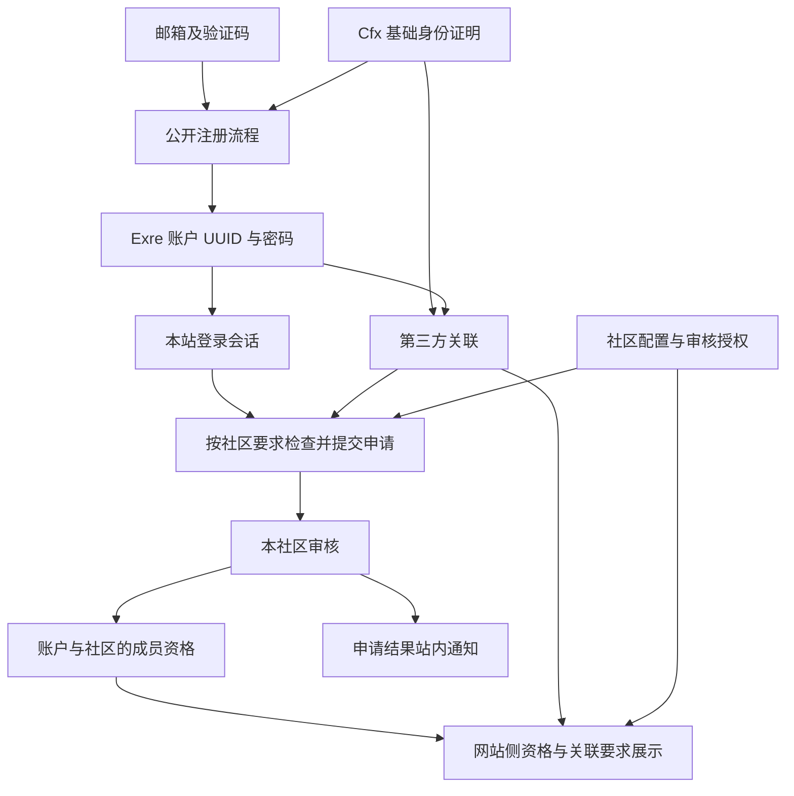

# Exre 公开注册、第三方关联与社区申请设计

日期：2026-10-12。

模块根目录：`.notes/public-registration/`。

状态：账户与社区业务方向已经逐项确认；本文已完成设计自查，等待用户全文审阅。本文包含为保持流程完整而补充的技术边界，全文确认后才进入 RFC，不开始实现。

后续 RFC 目录：`.notes/public-registration/rfcs/`。

## 1. 目标与交付范围

Exre 提供统一平台账户，一个游戏服务器对应一个社区。注册 Exre 账户公开开放，加入社区仍需申请和审核。账户身份、第三方关联、申请事实与社区成员资格分别管理。

本期完成网站侧闭环：

- 邮箱公开注册与 Cfx 注册、登录。
- Google、QQ 的禁用预留入口。
- 账户设置中的第三方关联信息、关联与解除关联。
- 按社区要求检查关联信息的登录后申请。
- 每个 Exre 账户对每个社区终身一次申请。
- 按社区划分的审核权限、申请结果查询、成员资格与站内通知。
- 替换现有申请审核后邀请注册的主流程，并保留既有数据。

本期不开发 FiveM 入服资源、服务器调用 Website 的协议或实际游戏放行。网站展示成员资格和关联要求满足情况；真实游戏准入属于后续独立设计。本期也不开放 Google、QQ 授权，不新增 Exre 邮箱修改、账号合并、重新申请、申诉、成员退出或社区封禁管理功能。

## 2. 已确认的业务决策

| 决策 | 规则 |
| --- | --- |
| 平台与社区 | Exre 是总体服务，一个服务器对应一个社区。 |
| 公开注册 | 创建平台账户无需社区审核；社区申请必须先登录。 |
| 账户标识 | 新账户生成永久 UUID；已有账户保留现有 ID。 |
| 邮箱 | 账户邮箱唯一，用于邮箱登录、注册查重和联系；不是业务关联主键。 |
| 邮箱注册 | 用户自行填写邮箱，完成邮箱验证后注册。 |
| 第三方注册 | 第三方默认提供邮箱及资料；注册邮箱只读，不执行 Exre 邮箱验证。 |
| 密码 | 所有账户都必须设置密码，包含第三方注册账户。 |
| 第三方邮箱重复 | 尚未关联的第三方身份带回已注册邮箱时，不建号、不自动合并，先登录已有账户再主动关联。 |
| 关联数量 | 每个 Exre 账户在每个平台最多一个关联；同一第三方身份同时只能关联一个 Exre 账户。 |
| 关联邮箱 | 设置中关联第三方时，第三方邮箱可以不同于 Exre 邮箱。 |
| 资料更新 | 第三方资料仅用于首次注册预填；后续登录不自动覆盖 Exre 资料。 |
| 解除关联 | 保留 Exre 账户、密码、申请记录和成员资格。 |
| 社区要求 | 社区独立决定所需关联信息；本期支持要求绑定 Cfx，Rifling911 启用此要求。 |
| 一次申请 | 唯一规则为 `userId + communityId`；pending、approved、rejected 均持续占用机会。 |
| Cfx 去重 | Cfx 不作为申请去重标识；另一个 Exre 账户可以使用相同 Cfx 身份申请同一社区，但仍须遵守当前关联唯一规则。 |
| 审核通过 | 授予该 Exre 账户的社区成员资格，不再签发注册邀请。 |
| Cfx 变更 | 解绑不删除成员资格；重新关联或更换 Cfx 不触发重新申请、重新审核。 |
| 审核权限 | 各社区配置自己的审核员，平台管理员管理授权。 |
| 范围 | 先完成网站侧，游戏端接入后续单独设计。 |

## 3. 当前实现与选择依据

当前账户模型已经区分账户 ID 与邮箱：`apps/server/src/db/schema.ts` 中 `auth_users.id` 是主键，`email` 有独立唯一约束，`password_hash` 必填。`apps/server/src/domains/join/invitations/service.ts` 默认使用 `randomUUID()` 创建账户。无需给既有账户重新生成 ID。

现有申请与邀请注册相互依赖：`apps/server/src/domains/join/applications/service.ts` 拒绝已有账户邮箱申请，按邮箱登记历史，审核通过后发出邀请；邀请完善负责建号，未建立具体社区成员关系。现有 `community_groups`、`community_group_memberships` 表表达身份分组，不能直接当作多个服务器社区的成员模型。

`apps/server/src/modules/cfx/` 已提供浏览器绑定、一次性身份凭证及服务端消费能力，不创建账户、不签发本站会话、不持久化账户关联。消费边界见 `.ai/knowledge/cfx/identity-lifecycle.md`。后续业务复用此公共能力。

当前加入 HTTP 接入见 `api/paths/join.yaml`、`apps/server/src/domains/join/api/handlers.ts`；申请与审核仍包含匿名和临时未授权入口。新流程必须同时替换其认证与授权规则。当前 `/register`、`/join/result` 和审核页入口见 `apps/web/src/App.tsx`。

已比较并选择“公开注册后登录申请”：

- 延续审核后注册，会继续让平台身份受单个社区审核约束，不符合 Exre 的总体服务定位。
- 允许匿名申请再注册，会增加认领、归属和重复申请处理，与已确认的登录前提冲突。
- 公开注册后申请，可以用稳定账户 ID 管理多个社区的独立审核结果。

## 4. 模块架构与数据关系

### 4.1 服务边界

- `modules/auth/` 管理账户密码登录、第三方登录消费后的本站会话和公开注册账户写入。复用现有会话、停用复核与密码哈希队列。
- 公共第三方关联能力管理持久关联、按平台及外部身份查找账户、关联和解除关联。由 auth 和社区业务依赖，不依赖具体社区流程。
- `modules/cfx/` 继续只负责外部身份证明。它不引用 auth、社区或申请业务，不直接写账户表。
- 公共邮箱验证能力为自行填写邮箱的注册提供发码、验证和短期授权；不依赖社区获批或邀请资格。
- 社区业务拥有社区配置、审核员授权、成员资格和关联要求计算。复用既有平台 `admin` 身份的可信授权来源，不通过普通注册授予管理身份。
- `domains/join/` 管理账户对指定社区的一次申请、表单、附件和审核事实；通过公开服务依赖账户、关联、社区及通知能力。
- Web 编排流程和导航；共享组件通过 props 展示和提交，不直接访问 API。

RFC 必须固定新增能力的具体模块目录、factory 参数、Fastify decorator、依赖声明和模块本地 `fastify.d.ts`。全部 API 经各模块 `api/`、统一 handler 汇总及一次 Glue 注册接入，遵守 `.ai/architectures/server/request-lifecycle.md`。

### 4.2 持久化职责

下列为目标业务实体，物理表名和迁移顺序由 RFC 固定。

| 实体 | 职责与必须保持的约束 |
| --- | --- |
| Exre 账户 | 保留稳定 `userId`、唯一规范化邮箱、密码哈希及现有资料。新账户 UUID 创建一次，任何关联操作都不改变它。 |
| 邮箱注册验证材料 | 保存邮箱验证码摘要、到期、消费、冷却和失败窗口；不保存密码或明文码。验证只授权对应邮箱注册，不授予本站会话。 |
| 第三方关联 | 保存 `userId`、平台、稳定外部用户 ID、展示所需最小资料和关联时间。`provider + externalUserId` 与 `userId + provider` 分别唯一。 |
| 社区 | 稳定社区标识、展示名称、本期的 Cfx 关联要求。Rifling911 使用已有路由标识 `rifling-911`。 |
| 社区审核授权 | 关联社区和审核员 `userId`，保存授予人及时间；一个人可审核多个被明确授权的社区。 |
| 社区申请 | 明确关联 `userId` 和社区，保存提交时资料快照及审核事实；数据库唯一约束覆盖该组合的全部状态。 |
| 表单及证明附件 | 延续现有完整表单校验、版本读取及附件原子保存规则，不扩大为存储迁移或无关表合并。 |
| 社区成员资格 | 账户与社区的唯一关系，关联通过的申请和生效时间；解除第三方关联不会删除此关系。 |

邮箱规范化沿用现有规则：去除首尾空白、转换小写，再校验格式与长度。不同邮箱服务的点号、加号等不做额外折叠。邮箱变更功能不在本期，仍以 `userId` 关联所有新业务。

第三方返回邮箱不自动成为本站已验证邮箱事实。按照已确认规则，它允许免本站邮箱验证注册；系统不得因此伪造 `email_verified=true`。本期不新增 OIDC 邮箱验证 claim，也不改变既有账户 UUID 身份映射。登录中的第三方资料变化不更新账户邮箱。

## 5. 注册与登录流程

### 5.1 邮箱注册

1. 用户选择邮箱注册并填写邮箱。
2. Server 查重并发出注册验证码；发码、验证、最终建号均独立检查实际状态。
3. 验证成功签发只允许对应邮箱注册的短期凭证。
4. 用户填写名字和必填密码；邮箱在已验证步骤中只读。返回修改邮箱使原验证结果失效。
5. Server 在密码哈希完成后的事务中复查凭证、邮箱唯一性，生成 UUID 并创建账户。
6. 沿用当前注册成功后进入登录的行为，不在注册步骤自动签发本站会话。

邮箱验证码沿用当前邀请验证码的强度和时间约束：6 位数字、10 分钟有效、60 秒发送冷却、10 分钟内累计 5 次失败锁定至窗口结束；注册完善授权最多 30 分钟。验证不与社区审批关联。摘要、消费、失败计数、邮件投递与冷却的具体复用边界在 RFC 中固定，公共能力不得反向依赖 join 业务。

### 5.2 Cfx 注册及登录

1. 用户从登录或注册入口发起 Cfx 授权。
2. Server 经现有 Cfx 服务消费本浏览器的一次性身份凭证，取得真实外部身份；客户端提交的邮箱、用户名或 Cfx ID 不能代替证明。
3. 如果这个外部身份已经关联账户，按 UUID 查找账户，复核启用状态和关联仍有效，签发本站会话。第三方当前邮箱变化不影响已有关联的登录查找。
4. 如果尚未关联且返回邮箱已被注册，显示已有账户提示，提供正常登录入口；不创建第二个账户，不自动关联。用户登录后主动发起一次新的关联授权。
5. 如果尚未关联且邮箱未注册，展示完善注册表单：邮箱只读，名字由 Cfx 资料预填且可编辑，密码必填。不发送 Exre 邮箱验证码。
6. 最终事务复查邮箱及关联唯一性，原子创建账户和 Cfx 关联；任何冲突不得留下半个账户或半条关联。成功后进入登录。

尚未完成的注册不永久占用邮箱。流程材料短期、有界，保留服务端可信身份与本次用途，不持久化原始第三方密钥。Cfx 凭证一旦消费不复活；后续事务失败、授权到期或用户切换流程时，重新授权，不能复用客户端资料继续注册。

Cfx 返回资料只预填名字等已支持字段。本期不新增从外部 URL 自动下载头像的链路；头像继续使用现有本人上传服务。QQ 联系字段不代表 QQ 授权关联。

Google、QQ 在登录、注册和关联设置中显示暂未开放；禁用入口不发请求。未来接入平台专属证明能力时遵守本设计的账户和关联语义，本期不引入通用 OAuth 框架或假成功适配器。

### 5.3 会话与失败恢复

邮箱密码登录保留现有能力。第三方登录使用与普通登录相同的会话签发、用户停用复核和浏览器 token 写入规则，不另建第三方会话体系。

发起关联的用户和本站会话必须与最终提交时相同；退出或换号使原流程不可用于新账户。第三方登录签发前复查关联，解除关联后不能凭迟到授权结果重新恢复关联。

已签发的本站会话不因普通解除关联自动撤销；密码和平台账户保持有效。账户停用、明确退出和既有会话撤销继续使用当前生命周期。

## 6. 关联账户设置

设置新增关联账户分区，展示平台、关联状态、外部显示名称、最小外部身份标识和关联时间。关联与解除关联的称谓统一使用这些动作，不使用社交关注语义。

关联前必须已有有效本站会话，Server 复核本次外部授权及当前账户。设置中不要求第三方邮箱与 Exre 邮箱相同，也不以邮箱相等证明关联；外部身份已关联他人时返回冲突。当前平台已有另一关联时，先明确解除旧关联，再发起新的授权，不静默替换。

解除关联要求本人有效会话及确认操作，Server 在事务中复核归属并移除有效关联。解除后该平台不能再用于登录；所有账户都有密码，因此邮箱密码登录继续可用。移除关联不删除账号、申请、审核决定或社区资格，也不自动新建另一账号。

如果已加入社区要求 Cfx，设置中展示该影响：解除后需要重新关联才能满足社区要求。该提示不阻止已确认的解除操作。

## 7. 社区申请、审核与结果

### 7.1 提交申请

社区介绍页面可以匿名浏览，提交申请必须登录。未登录时进入登录流程，成功后返回原社区，不自动提交草稿。

Rifling911 提交前要求已有 Cfx 关联。用户未关联时进入关联流程，完成后继续原申请；最终提交时 Server 再次检查真实关联，不能仅依赖页面早先检查。

申请人由本站会话确定，不接受 body 中的用户 ID 或邮箱作为归属。表单保留现有新玩家、经验玩家类别及内容校验，提交时由账户资料建立邮箱和名字等快照；快照用于审核展示，不作为账户身份主键。Cfx 展示资料可作为当时的关联快照保存，但不能成为申请唯一性约束。

完整申请、表单和附件在一个事务内保存。唯一约束为 `userId + communityId`，覆盖所有状态；并发提交只允许一个成功。提交失败不占用申请机会，成功后不提供删除、修改或重新提交接口。申请尚未提交的草稿继续只存页面内存。

### 7.2 一次申请及状态

申请状态保持 `pending`、`approved`、`rejected`。pending 才能进入审核决定；重复同一决定返回已有结果，相反决定冲突。所有状态都持续占用该账户在该社区的一次申请机会。

一次申请针对 Exre UUID，Cfx 不参与去重。此前用于匿名申请的规范化邮箱登记不再限制新账户对其他社区申请。解除关联或更换 Cfx 不重置历史，也不自动取消待审核申请；审核资格属于 Exre 账户，实际关联要求满足情况单独展示。

### 7.3 审核与授权

社区审核员只能读取和审核被明确授权社区的申请，列表、详情、附件下载和决定写入都检查相同范围。所有审核入口要求本站会话；跨社区请求不泄露申请资料。

平台管理员管理社区配置及审核员授权，审核操作要求对应社区授权；平台管理员可以被显式授予该权限。审核操作记录真实 `reviewedByUserId`、决定和时间，不再固定为 null。

审批写入前复查审核员授权、申请归属与 pending 状态。通过时在同一事务内写入审核事实、社区成员资格和站内通知业务事件；拒绝时写入拒绝事实和通知事件。任一步持久化失败全部回滚。异步通知投影失败不撤销已提交决定，按现有通知机制重试。

通过的资格授予 Exre UUID。审核时已经解绑 Cfx 不删除申请，也不阻止审核员形成决定；关联条件与成员资格独立计算。成员绑定新的 Cfx 时不需要再次申请或审核。

### 7.4 本人查询及网站侧就绪状态

用户登录后查看本人在各社区的申请状态、成员资格和缺失要求。保留 `/join/result` 作为登录后本人结果入口，替换按任意邮箱查询他人状态的旧接口语义。已有社区页面继续指向自己的社区，不把审核状态或凭证写进 URL。

网站展示分别计算：

- 是否已有通过申请产生的成员资格。
- 是否满足当前社区关联要求；本期为要求 Cfx 的社区检查有效 Cfx 关联。
- 网站侧是否满足该社区条件：上述两项同时满足。

“网站侧条件满足”不证明真实游戏端已接入或允许入服。现有 Cfx 模块输出是论坛身份，游戏端如何证明并映射该身份属于下一阶段，不接受本人资料中手填的 FiveM ID 作为本期已验证身份。

### 7.5 通知

通过和拒绝分别注册明确的申请结果通知事件，按申请 ID 和决定去重，受众只包含该申请人 UUID，审核人作为 actor。事件进入现有封闭 catalog，按本人资格变化使用必要服务通知，不由客户端选择通知级别。

通知跳转到固定本人结果入口，沿用现有受限 HTML 和 action 校验。结果页始终以实际申请事实为准。站内通知异步到达，不承诺审批响应时已被用户读取。注册验证码继续使用邮件；本期不新增审核结果邮件，也不再发送注册邀请邮件。

## 8. Contract 与页面接入

`api/openapi.yaml` 及其路径、schema 源文件仍是唯一 HTTP Contract。本设计只确定能力，新增路径、operationId、DTO、状态码矩阵和破坏性变更清单在 RFC 中固定，不把拟议接口当作已存在能力。

RFC 必须覆盖以下能力：邮箱注册发码与验证、公开注册完善、Cfx 注册与登录消费、本人关联查询与变更、社区配置及审核授权管理、本人社区申请与结果、社区范围内审核和附件读取。

现有匿名申请提交、按邮箱查询、邀请资格检查、邀请发码与验证、邀请完善、审核邀请重发需要明确替换或移除。全部变更按破坏性 Contract 修改单独评审，不自行发明版本策略、兼容层或第二套路由。

保留顶栏桌面和移动注册入口、注册 Modal 及独立 `/register` 页；它们复用同一新流程。登录入口接入 Cfx，Google、QQ 禁用预留。复用现有设置 Modal 和资料页宿主展示关联分区。

表单遵守 `.ai/rules/frontend-forms.md`：React Hook Form、Zod、ExUI 表单控件，字段及持续错误属于表单。应用层经生成 Client 调用 API，临时通知从 `@exre/exui` 使用 `ExMessage`，遵守 `.ai/rules/frontend-notifications.md`。不复制 DTO、不直接 fetch、不增加通知宿主。

验证码、密码、注册授权、Cfx ticket 只在短期受控流程中使用，不进入浏览器持久存储、普通日志或可分享链接。晚到响应不能跨用户、跨邮箱或跨流程写入资料和成功反馈。

## 9. 旧数据与切换边界

本期不重置数据库，不删除账户、头像、原申请、证明附件或原邀请投递历史。schema 变更通过显式 migration 执行；启动只检查，不迁移、不重建账号。

迁移先清点现有数据并输出脱敏分类数量。现有匿名流程只有 Rifling911 申请入口，旧申请归入该社区的历史范围。

- 既有账户 UUID、密码、会话关联及 OIDC 身份映射保持不变。
- 如果已完成邀请明确关联真实账户，并且对应申请已通过，可以据持久外键关系迁移该账户的 Rifling911 申请归属和成员资格；迁移不靠同名或邮箱相同猜测。
- 未完成邀请和其他无法证明账户归属的匿名申请保留为只读历史，包含审核事实、完整表单和附件，不自动认领到新注册账户。它们不计作某个尚未建立关系的 Exre UUID 的一次申请。
- 无账户归属的旧审核资料只向已授权的 Rifling911 审核员或管理该历史访问授权的平台管理员开放，不保留匿名查询或下载入口。
- 切换后旧邀请及完善凭证不再授权建号，历史投递事实仍保留；旧链接展示流程已调整及新注册入口，不能兑换旧凭证。
- 如果确定归属的旧记录存在同一账户同一社区多条记录、损坏外键或决定冲突，迁移拒绝继续并保留原数据；先形成针对实际数据的修复方案，不能静默选择或丢弃记录。

当前未读取本机开发库，因此不声明现有记录数量或迁移已经可执行。RFC 必须给出历史只读数据的物理保存方式、冲突检查、凭证失效、迁移测试及切换次序，满足上述确定规则后才允许实施。当前账户和头像目录保留规则见 `.ai/databases/data-model.md` 及 `.ai/architectures/runtime/runtime-boundaries.md`。

## 10. 错误与并发规则

| 场景 | 对外行为 |
| --- | --- |
| 注册邮箱已经存在 | 不建号，显示已有账户并引导登录；不返回密码、申请详情或关联信息。 |
| 邮箱或外部身份最终写入竞争 | 数据库唯一约束裁决，返回固定冲突；账户和关联全部回滚。 |
| Cfx 授权到期、已消费或业务失败 | 清理当前流程，明确要求重新授权，不复活旧 ticket。 |
| 第三方身份已关联他人 | 拒绝关联，不暴露另一账户资料。 |
| 会话失效、退出或换号 | 拒绝本人操作，丢弃原流程晚到结果；遵守当前 token 归属规则。 |
| 社区要求未满足 | 返回明确缺失项并提供对应关联入口，不保存半份申请。 |
| 已申请该社区 | 返回本人已有状态，不覆盖历史，不开放重新申请。 |
| 审核范围不匹配 | 拒绝读取或写入，不暴露跨社区资料。 |
| 并发通过与拒绝 | 只提交一个决定；相同决定幂等，相反决定冲突。 |
| 通知投影失败 | 审核事实保持提交，通知投影按既有机制重试。 |

所有异常经过 `apps/server/src/errors.ts`，只返回 Contract 校验错误或固定业务文案。邮件投递失败、密码队列容量、请求限流和外部授权容量采用明确可重试失败，不回显第三方、数据库或邮件适配器原始异常。

## 11. 验证与验收

本设计不执行应用实现或验收，下列是后续实施必须满足的检查。

### 11.1 自动检查

- 邮箱注册覆盖发码、失败窗口、验证码消费、邮箱锁定、密码必填、最终查重及并发事务回滚。
- Cfx 注册及登录覆盖真实 Cfx 服务的消费调用链、已有绑定优先、只读邮箱、不执行本站邮箱验证码、重复邮箱分支、强制密码、停用复核和一次性凭证失败恢复。只 stub 外部请求等边界，不能替换被检验的消费函数证明自身正确。
- 关联覆盖本人归属、跨用户及跨会话拒绝、平台和身份唯一性、第三方邮箱不同、解除后密码登录继续可用、旧授权不能恢复关联。
- 社区覆盖一个账户申请多个社区、同一社区全状态唯一、失败提交不占机会、Cfx 不参与申请去重、提交时要求复核、解绑及换绑不改变申请和成员资格。
- 审核覆盖列表、详情、附件和决定的社区隔离、授权撤销复核、真实审核人、并发相同与相反决定、成员资格和通知事件的事务原子性。
- 历史迁移覆盖原 UUID 和资料保留、已完成邀请的可信映射、匿名历史保留、旧凭证失效、冲突拒绝及非空数据库切换。
- Contract 从统一生成物验证真实 Fastify HTTP 响应、原始 handler 返回值、生成 Client 调用和双向 operation 覆盖。
- 数据库测试使用 PostgreSQL Testcontainers 和逐用例 schema；Docker 不可用时失败，不连接本机开发库。
- API 改动依次执行 `pnpm api:lint`、`pnpm api:generate`、`pnpm typecheck`、`pnpm test`、`pnpm build`，并核对生成物，不手改生成 Client。

### 11.2 浏览器与真实外部验收

浏览器覆盖注册 Modal 和独立页、邮箱与 Cfx 两条注册路径、重复邮箱引导、关联分区、流程返回、申请草稿、本人结果、跨社区审核权限、加载与失败重试、焦点和退出换号的晚到响应。

真实 Cfx 授权、OAEP、实际 HTTPS 域名回跳与注册、登录、关联消费分别验收。本地手动 payload 和自动 HTTP 测试不能代替正式回跳。真实邮件适配器投递单独验收。

自动检查、真实浏览器、外部授权和邮件、数据库切换分别报告。游戏入服与公网部署标记为本期范围外，不以网站侧成功声明游戏放行或上线完成。

## 12. 技术补充、证据缺口与下一步

为形成可实施的完整设计，本文补充以下规则，等待全文审阅一并确认：注册成功沿用转登录行为；验证码沿用现有强度与期限；Cfx 资料不自动下载头像；批准或拒绝使用必要站内通知；历史申请按可证明的账户关系迁移，其余保留只读。

证据缺口有明确边界：本机旧数据数量未清点；正式 Cfx 回跳与 OAEP 不能由当前文档证明；本仓库未发现游戏端入服对接。这些不改变已确认产品方向，但限制实施迁移和真实外部验收的结论。

全文批准后调用 `technical-design-doc-creator`，保持本文为源设计，在 `.notes/public-registration/rfcs/` 默认形成一份端到端 RFC。RFC 固定 Contract、物理模型、模块接口、邮件及凭证生命周期、授权与并发、切换和验收路径；如拆分，保持账户与社区依赖次序并明确各自验证边界。

设计批准不等于实现、提交、推送、迁移或部署授权。稳定结论写入 `.ai/` 前按工程规则另行询问，本文和 RFC 保留在本模块 `.notes/` 下。
